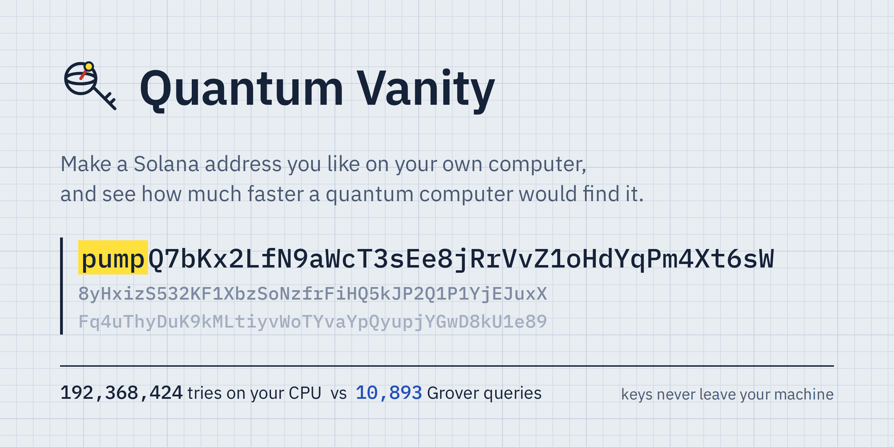
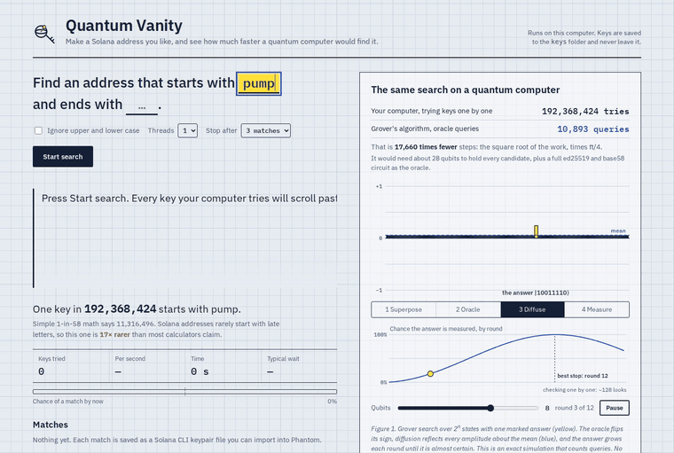
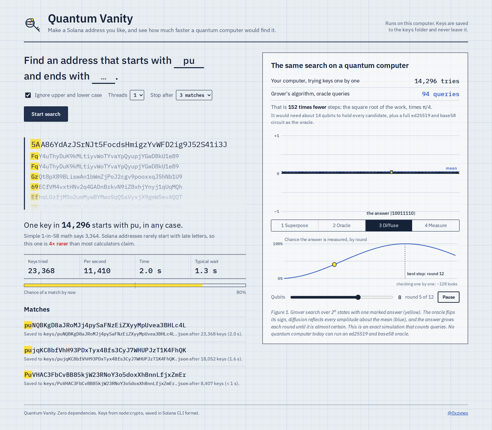
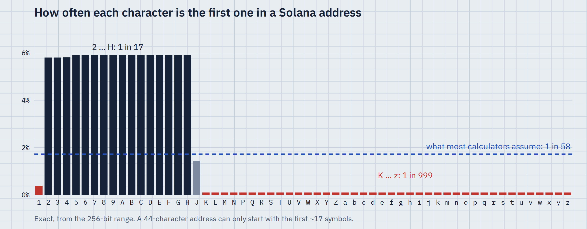
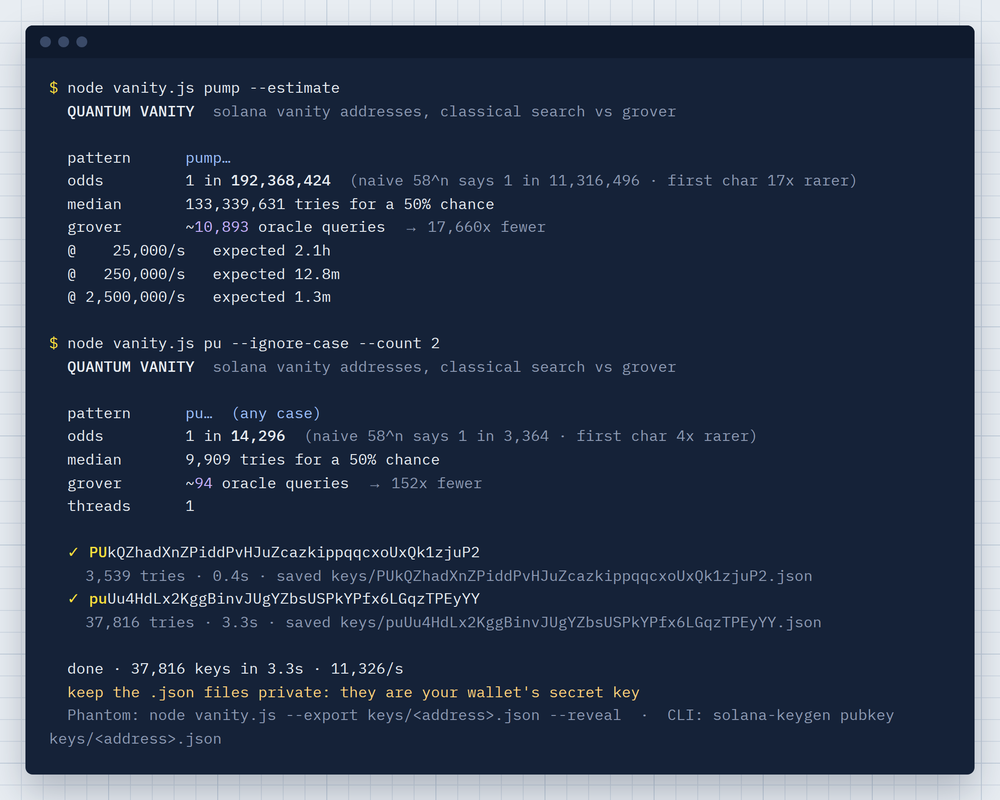

<p align="center">
  
</p>

<p align="center">
  
  
  
  
  
  
</p>

<p align="center">
  <a href="#quick-start">Quick start</a> ·
  <a href="#every-vanity-calculator-is-wrong-about-the-first-character">The first-character trap</a> ·
  <a href="#use-it-in-phantom">Use it in Phantom</a> ·
  <a href="#security">Security</a>
</p>

<p align="center">
  
</p>

---

## What it does

**Left side, real.** Type one word like `pump`, or several like `pump, bin, moon`, and choose whether it should start the address, end it or appear anywhere. Every CPU core generates ed25519 keypairs with Node's built-in crypto until one encodes to an address that matches. The keypair is saved as a Solana CLI file you can import into Phantom or use with `solana-keygen`.

While it searches, it can also keep **pretty addresses** on the side, saved to `keys/lucky`:

| Pattern | Example | On a fast PC |
|---------|---------|--------------|
| Repeated digits | `…77777…` anywhere, `…8888` at the end | every ~15 s |
| Counting digits | `…12345…`, `…98765…` | every ~35 s |
| Same character | `aaaaa…` at the start, 6 in a row anywhere | every ~2 min |

Base58 has no `0`, so digits run from 1 to 9.

Every line in the live ticker is a real wallet. Hover to pause it and click any address you like to keep it in `keys/kept`. Scrolled past too fast? Type any piece of it into **Missed one?** and pick it from the last ~15 minutes of the ticker. Only those recent keys are held in memory, so nothing piles up on disk.

**Right side, quantum.** The same search as Grover's algorithm on an exact statevector: an oracle flips the sign of the right answer, diffusion reflects every amplitude about the mean, and the answer's probability climbs to ~100% after about **√N** queries instead of **N**.

```
  pattern      pump…
  odds         1 in 192,368,424   (naive 58^n says 1 in 11,316,496 · first char 17x rarer)
  grover       ~10,893 oracle queries → 17,660x fewer
```

<p align="center">
  
</p>

---

## Every vanity calculator is wrong about the first character

Most tools say each character is 1 in 58. That holds for every character **except the first one**.

A Solana address is a 256-bit number written in base 58, and

```
58^43  <  2^256  <  58^44
```

<p align="center">
  
</p>

so most addresses have 44 characters and can only **start** with one of the first ~17 symbols (`1`–`H`). Letters later in the alphabet only show up first on the rarer 43-character addresses.

| First char | Real odds | Naive odds |
|-----------|-----------|------------|
| `1` | 1 in 256 | 1 in 58 |
| `2` … `H` | **1 in 17** | 1 in 58 |
| `J` | 1 in 70 | 1 in 58 |
| `K` … `z` | **1 in 986** | 1 in 58 |

So `pump…` is **17x harder** than calculators claim, while `Ab…` is **3.4x easier**. Quantum Vanity computes the first-character odds exactly with BigInt, and the test suite checks them against real generated keys.

---

## Quick start

Requires [Node.js](https://nodejs.org) 18.17 or newer. No dependencies, no build step, no internet.

```bash
git clone https://github.com/0xzynex/quantum-vanity.git
cd quantum-vanity
npm start            # open http://localhost:5180
```

Or straight from the terminal:

```bash
node vanity.js pump                    # address starting with "pump"
node vanity.js pump,bin,moon           # starting with any of these words
node vanity.js --contains moon         # "moon" anywhere in the address
node vanity.js pump --lucky            # also keep pretty ones: 77777, …8888, 12345, aaaaa…
node vanity.js pump --digits --counting   # only the number patterns
node vanity.js Zyn --ignore-case       # any case
node vanity.js So --suffix 1           # prefix + suffix
node vanity.js Ab --count 5            # five hits
node vanity.js pump --estimate         # odds and time only
node vanity.js --grover 10             # Grover on 10 qubits, in the terminal
node vanity.js --export keys/<a>.json  # secret key for Phantom (add --reveal)
npm test                               # 15 tests
```

<p align="center">
  
</p>

## Use it in Phantom

**Phantom or any wallet that imports a private key:**

```bash
node vanity.js --export keys/<address>.json            # shows the address, hides the secret
node vanity.js --export keys/<address>.json --reveal   # prints the base58 secret key
```

In Phantom: *Add account → Import private key*, paste the secret.

**Solana CLI:** the file is already in its format.

```bash
solana-keygen pubkey keys/<address>.json
solana config set --keypair keys/<address>.json
```

---

## How long will it take?

Rough numbers for a modern 12-thread CPU (~250k keys/s):

| Pattern | Odds | Expected time | Grover queries |
|---------|------|---------------|----------------|
| `Ab…` | 1 in 986 | instant | 25 |
| `So…1` | 1 in 3.3M | ~13 s | 1,430 |
| `Zyn…` | 1 in 3.3M | ~13 s | 1,430 |
| `pump…` | 1 in 192M | ~13 min | 10,893 |
| `pump…` any case | 1 in 12M | ~48 s | 2,723 |
| `pumpfun…` | 1 in 3.8×10¹³ | ~4.8 years | ~4.8M |

Run `node vanity.js <pattern> --estimate` for your exact odds.

---

## Grover in one paragraph

Put N candidates in equal superposition. Each round the **oracle** flips the sign of the marked state and **diffusion** reflects all amplitudes about their mean, which pumps amplitude into the marked state. After k rounds

```
P(marked) = sin²((2k + 1)·θ),   sin θ = √(M/N)
```

which peaks at k ≈ (π/4)·√(N/M). The simulator in `src/grover.js` reproduces this formula to 1e-9 and the dashboard animates every oracle and diffusion step.

---

## Security

- Keys are generated with `node:crypto` (OpenSSL's CSPRNG and ed25519) on your machine
- Every hit is re-derived from its seed before it is saved
- Files are written with `0600` permissions into `./keys`, which is git-ignored
- The web app listens on `127.0.0.1` only, serves a fixed whitelist of files, and never sends secret keys to the browser
- No network calls, no telemetry, no dependencies to audit

Still: treat any vanity wallet like any wallet. Back up the file, never share it, and read the code. It's short.

---

## Architecture

```
quantum-vanity/
├── vanity.js          CLI
├── server.js          local web app (127.0.0.1, SSE progress)
├── index.html         dashboard
├── web/               dashboard script and styles
├── assets/           README images, logo, fonts (IBM Plex, SIL OFL)
├── src/
│   ├── base58.js      encode / decode
│   ├── keys.js        ed25519 keypairs, Solana CLI file format
│   ├── pattern.js     matching, validation, exact odds
│   ├── grover.js      Grover statevector simulator
│   ├── search.js      multi-threaded search, saving
│   └── worker.js      one search thread
└── test/
    └── vanity.test.js
```

---

## Honest note

The vanity search is real. The Grover side is a classical simulation that counts **oracle queries**. A real quantum computer would need thousands of error-corrected logical qubits to run an ed25519 + base58 oracle, and no such machine exists today. The point is to show the shape of the speedup, not to promise one.

---

## License

MIT for the code. IBM Plex fonts are included under the SIL Open Font License (`assets/fonts/OFL.txt`).

<p align="center">
  <a href="https://x.com/0xzynex"><b>@0xzynex</b></a>
</p>
